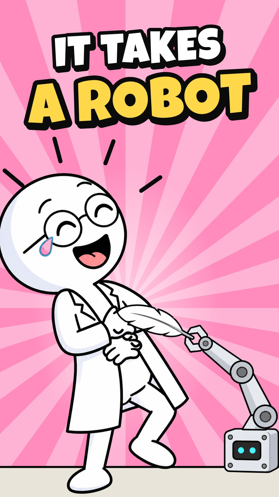
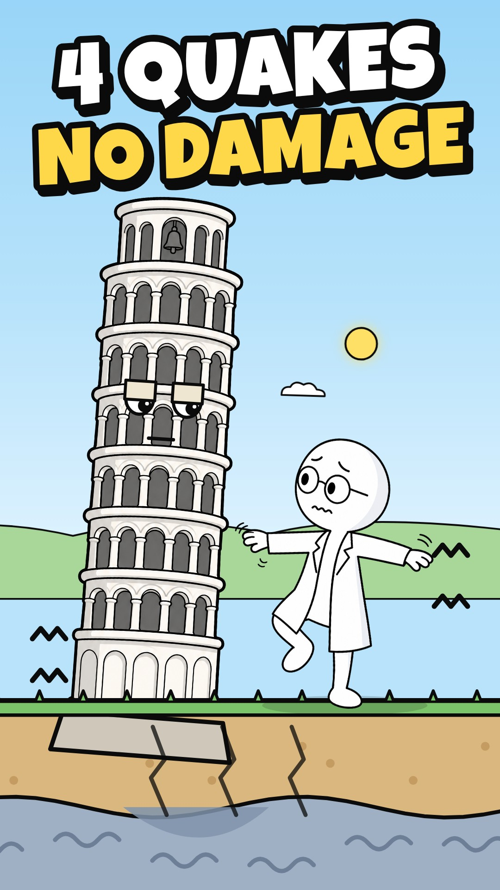
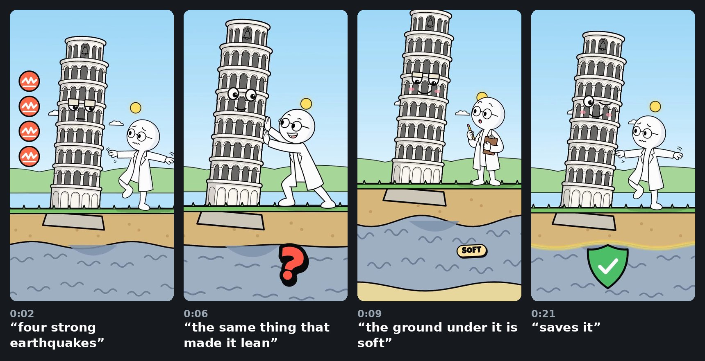

# YT-2D


**Cut-out cartoon YouTube Shorts, animated in code.**

YT-2D is a small production line for science Shorts. Each episode takes one surprising question and checks the facts against real research. It turns about 60 spoken words into a 20–25 second vertical cartoon with a voice-over, sound effects, a thumbnail and a title.

The look is classic cut-out animation: flat 2D drawings with thick black outlines. An AI image model draws the characters and props as separate cut-out pictures. Everything that moves is code, written with [Remotion](https://www.remotion.dev/) (React for video): the camera, poses, physics, faces and effects. Because the animation is code, every beat lands on the exact spoken word. Any shot can be re-timed or rendered again in 4K without redrawing anything.

The aim is a repeatable recipe. Every episode uses the same round-headed scientist, the same drawing style and the same pipeline, so a new Short is mostly a new script, a handful of new pictures and new animation code.

## Finished Shorts

<table>
  <tr>
    <td align="center" width="25%">
      <br>
      <b>Why Pigeons Bob Their Heads (It's Not What You Think)</b><br>
      24.9 s · <code>PigeonShort</code>
    </td>
    <td align="center" width="25%">
      <br>
      <b>Why Don't We Just Nuke a Hurricane?</b><br>
      20.6 s · <code>HurricaneShort</code>
    </td>
    <td align="center" width="25%">
      <br>
      <b>You Can Tickle Yourself (You Just Need a Robot)</b><br>
      19.0 s · <code>TickleShort</code>
    </td>
    <td align="center" width="25%">
      <br>
      <b>Why the Leaning Tower of Pisa Survives Earthquakes</b><br>
      22.8 s · <code>PisaShort</code>
    </td>
  </tr>
</table>

All four are rendered at 2160×3840 (4K vertical) and 60 fps, with the voice and sound effects mixed in. The MP4 files aren't stored in git; the commands under [Running it](#running-it) render them again.

### 1. Why pigeons bob their heads


> A walking pigeon's head never actually moves backward. It freezes in place while the body moves forward, then darts ahead. You'd think that's for balance. But when scientists put pigeons on a treadmill, the bobbing stopped. Their legs kept walking, but their view never changed. So it's mostly about vision. Each freeze gives a steady view, like holding a camera still, which probably helps them spot movement.

**The story:**
1. A pigeon walks down a city street. A red guide line shows that its head holds still, then darts ahead.
2. The scientist guesses "balance" and wobbles on one leg.
3. He puts the pigeon on a treadmill. Its legs keep walking, but its head stays on the line, and its view of a bread poster on the wall never changes.
4. A close-up of its eye, then a camera held still.
5. The pigeon snaps a falling crumb out of the air, which loops back to the first frame.

The pigeon is a puppet. Its head, neck and body are cut from one AI picture, and its legs, eye and eyebrow are drawn in code, so it walks with the real hold-then-dart rhythm.

**Sources:**
- [Frost 1978](https://journals.biologists.com/jeb/article/74/1/187/22520/The-Optokinetic-Basis-of-Head-Bobbing-in-the): the treadmill experiment.
- [Troje & Frost 2000](https://journals.biologists.com/jeb/article/203/5/935/8418/Head-Bobbing-in-Pigeons-How-Stable-is-the-Hold): how still the head stays during the hold.
- [Davies & Green 1988](https://journals.biologists.com/jeb/article/138/1/71/5562/Head-Bobbing-During-Walking-Running-and-Flying): the hold helps pigeons spot moving objects.
- [Necker 2007](https://doi.org/10.1007/s00359-007-0281-3): a review. It notes that the benefit to the bird hasn't been fully tested, which is why the script says "mostly" and "probably".

### 2. Why don't we just nuke a hurricane?


> Why don't we just nuke a hurricane? Because the hurricane is way stronger than the bomb. A big one gives off as much heat as a ten-megaton nuclear bomb every twenty minutes. So one more bomb might not even slow it down. And the trade winds would carry the radioactive fallout straight to land. You'd probably keep the storm and add radiation.

**The story:**
1. The scientist stands on a beach with a lit bomb under a sleeping hurricane, which wakes up on "hurricane".
2. He throws the bomb and the camera follows it into the storm. The explosion only makes the hurricane look smug.
3. A clock shows the storm putting out a bomb's worth of heat every 20 minutes, and the hurricane yawns.
4. The trade winds carry a green fallout cloud to the shore, and the storm laughs while the scientist glows green.
5. He pulls out another bomb, which loops back to the first frame.

**Sources:** the figures come from [NOAA's hurricane research FAQ](https://www.aoml.noaa.gov/hrd/tcfaq/C5c.html). It was offline when we checked, so they were confirmed through two reports that quote it: [National Geographic](https://www.nationalgeographic.com/science/article/hurricanes-weather-history-nuclear-weapons) and [CNN via WTOP](https://wtop.com/weather-news/2019/08/why-not-bomb-a-hurricane-noaa-gets-asked-about-it-all-the-time/).

### 3. You can tickle yourself (with a robot)


> You can tickle yourself. You just need a robot and a fifth of a second. Your brain predicts what your own touch will feel like and turns it down, so it barely registers. But in one experiment, people tickled their own hand through a robot. When the robot waited a fifth of a second, the prediction was off, and it felt about as tickly as someone else doing it.

**The story:**
1. It opens on the payoff: a robot arm tickles the scientist, who's crying with laughter, and the tickle-meter at the top is maxed at the "someone else" mark. A stopwatch shows "0.2 SEC".
2. Then the explanation: the robot rolls away, and he tickles his own armpit with a feather, completely bored. His brain pops up in a thought bubble, watches the feather coming, and turns a knob all the way down, so the meter drops.
3. The robot rolls back in. He steers it with a joystick and it tickles his palm in sync, so the meter stays low.
4. The stopwatch adds a fifth of a second of delay, and his brain goes dizzy on "the prediction was off".
5. He bursts out laughing and the meter jumps back to the "someone else" mark, which is the first frame again. The last line runs straight back into the first.

**Sources:**
- [Blakemore, Frith & Wolpert 1999](https://doi.org/10.1162/089892999563607): the robot experiment. Ticklishness rose as the delay grew from 0 to 200 ms. At 200 ms it was no longer significantly different from a touch the person didn't cause.
- [Blakemore, Wolpert & Frith 1998](https://doi.org/10.1038/2870): brain scans showing the brain predicts and cancels the feeling of self-made touch.

### 4. Why the Leaning Tower of Pisa survives earthquakes



> The Leaning Tower of Pisa has survived at least four strong earthquakes without damage. And what's protecting it is the same thing that made it lean. The ground under it is soft. A tall, stiff tower on soft soil sways to a different rhythm than the shaking ground, so the shaking doesn't build up. Basically, the soil that tilted it is the soil that saves it.

**The story:**
1. It opens mid-earthquake. The ground jitters and the scientist wobbles on one leg, while the tower barely moves and looks bored. Four quake badges, "SINCE 1280" and "NO DAMAGE" pop up.
2. The open loop: he props the tower up as if he's what protects it, while a big red "?" sits over the cut-away soil.
3. The answer: the camera tilts down, the "?" pops, and the soft clay jiggles with a "SOFT" tag. Then "58 m" and "STIFF" tags appear.
4. Two metronomes show the ground's fast rhythm and the tower's slow one. A red ghost tower swings in step with the shaking, wider and wider, until a big X crosses it out.
5. The soil glows, a shield pops over the clay on "saves it", and the shaking starts again, which is the first frame.

**Sources:** [University of Bristol, 2018](https://www.bristol.ac.uk/news/2018/may/tower-of-pisa.html), on the study led by Roma Tre University. It says the 58-metre tower has survived "undamaged, at least four strong earthquakes … since 1280". Its height and stiffness, together with the soft soil, change how it vibrates "in such a way that the Tower does not resonate with earthquake ground motion". The results were presented at the 16th European Conference on Earthquake Engineering.

## The house style

- **Format:** vertical 9:16, 20–25 seconds. The voice sets the length.
- **Script:** 50–70 words of plain spoken English, with every fact checked against primary sources. No "Did you know", no hype, no calls to action. Where the science is uncertain, the script says so ("mostly", "probably").
- **Hook:** frame 0 and the first line show the strangest true thing, often the payoff, never a setup. There's motion and a sound from the first frame, and no pause longer than about 0.3 s in the first seconds (`scripts/tighten.py` trims them).
- **Open loop:** the first lines raise a question the viewer can't answer yet, and the answer lands in the last third. One "but" turn mid-way re-hooks.
- **Loop:** the last frame matches frame 0, and the last line runs back into the first.
- **Titles** open the question; they don't give away the payoff.
- **Beats:** one visual beat per line, landing on the exact spoken word, with one gag per beat.
- **Art:** flat 2D cut-outs with thick black outlines and flat colours. The same round-headed scientist with glasses and a lab coat appears in every episode.
- **Motion:**
  - a 2.5D multiplane camera with depth of field
  - squash-and-swap pose changes instead of cross-fades
  - anticipation and follow-through, and real projectile physics
  - breathing, small impact shakes and faces on objects
- **Sound:** effects on their own layer under the voice.

## How a Short is made

| Step | What happens | Where |
|---|---|---|
| 1. Script | Research a surprising question, check it against papers, universities and agencies, and write the voice-over. | `images/*/beats.md`, this README |
| 2. Voice | The voice-over is generated with the ElevenLabs voice "Chris" through vidIQ, then the pauses in the first seconds are trimmed. | `public/*/vo/take*.mp3`, `scripts/tighten.py` |
| 3. Word timings | faster-whisper finds when each word is spoken; pauses are found from loudness. | `words.py` → `images/*/words.json` |
| 4. Beat sheet | Lists what's on screen and which sound plays for every line, timed to the word. | `images/*/beats.md` |
| 5. Pictures | GPT Image 2.5 draws each pose and prop on a flat key colour. Earlier pictures are used as references to keep the characters and style consistent. | `images/*/prompts.md`, `images/*/raw/` |
| 6. Cut-outs | The background is keyed out to transparency and the outline edges are cleaned. Each sprite is then measured (feet, head, eye, the bomb's fuse…) so code can line it up. | `key.py`, `prep_*.py` → `src/*/sprites.ts` |
| 7. Animation | Remotion compositions draw the camera, layers, poses, physics and effects in code. | `src/pigeon/`, `src/hurricane/`, `src/tickle/`, `src/pisa/` |
| 8. Sound | Sound effects are synthesized in Python and mixed on their own layer. | `sfx.py`, `src/*/Sfx.tsx` |
| 9. QA | Three checks: stills and contact sheets; a scan for sudden jumps between frames; a check of size, frame rate, length and loudness. | `scripts/` |
| 10. Render | The 1080×1920 compositions are rendered at 2× scale, giving 2160×3840 at 60 fps. | `npx remotion render` |
| 11. Packaging | Thumbnails are Remotion stills built from the same art. Titles are brainstormed and scored with vidIQ. | `src/thumbs/`, `thumbnails/` |

## Repository layout

```
src/
  Root.tsx        registers the videos, thumbnails and channel art (PigeonShort, HurricaneShort, TickleShort, PisaShort, the four thumbnails, ChannelBanner, ChannelPicture)
  pigeon/         pigeon Short: shots (Street, Lab, Close, CamGuy), pigeon rig and walk, effects, sound mix, beat times
  hurricane/      hurricane Short: one continuous 2.5D shot, sound mix, beat times
  tickle/         tickle Short: one lab set, brain bubble, robot, tickle-meter, sound cues, beat times
  pisa/           Pisa Short: one shot of the tower over a soil cross-section, quake model, metronomes, sound cues
  thumbs/         thumbnails, rendered as Remotion stills
  channel/        channel banner and picture, rendered as Remotion stills
public/           everything the videos load: cut-out sprites, voice-overs, sound effects, thumbnail font
images/
  pigeon/         prompts, beat sheet, word timings, raw and keyed pictures, QA sheets, pipeline scripts
  hurricane/      the same for the hurricane Short
  tickle/         the same for the tickle Short
  pisa/           the same for the Pisa Short (+ sfx.py for the rumble and creak)
scripts/          QA tools (stills, contact sheets, pop scan, verify) and the README storyboard maker
thumbnails/       final thumbnails, ready to upload (1080×1920 JPG)
publish/          what goes on YouTube: upload details, channel banner and picture, channel text
docs/             storyboard strips used in this README
```

## Running it

You need Node.js (the project was built with Node 22) and ffmpeg. Python 3 with numpy, opencv-python and Pillow is only needed for the QA tools and for remaking assets. Word timings also need faster-whisper.

```bash
npm install
npm run studio      # Remotion Studio: play and scrub both Shorts in the browser
```

Render the Shorts in 4K, the thumbnails and the channel art:

```bash
npx remotion render src/index.ts PigeonShort out/pigeon-head-bob-4K.mp4 --scale=2 --crf=16 --pixel-format=yuv420p
npx remotion render src/index.ts HurricaneShort out/hurricane-nuke-4K.mp4 --scale=2 --crf=16 --pixel-format=yuv420p
npx remotion render src/index.ts TickleShort out/tickle-self-4K.mp4 --scale=2 --crf=16 --pixel-format=yuv420p
npx remotion render src/index.ts PisaShort out/pisa-earthquake-4K.mp4 --scale=2 --crf=16 --pixel-format=yuv420p
npx remotion still src/index.ts PigeonThumb out/pigeon-thumbnail.png
npx remotion still src/index.ts HurricaneThumb out/hurricane-thumbnail.png
npx remotion still src/index.ts TickleThumb out/tickle-thumbnail.png
npx remotion still src/index.ts PisaThumb out/pisa-thumbnail.png
npx remotion still src/index.ts ChannelBanner publish/channel-banner.png
npx remotion still src/index.ts ChannelPicture publish/channel-picture.png
```

Check a render:

```bash
node scripts/stills.mjs out/qa 0.5 HurricaneShort 0 4.8 9.5 18.3   # PNG stills at these seconds
python3 scripts/sheet.py out/qa out/qa-sheet.jpg 4                   # contact sheet of those stills
python3 scripts/popscan.py out/hurricane-nuke-4K.mp4                 # flags sudden jumps between frames
bash scripts/verify.sh out/hurricane-nuke-4K.mp4                     # size, frame rate, frame count, length, loudness
python3 scripts/storyboard.py out/hurricane-nuke-4K.mp4 docs/hurricane-storyboard.jpg \
  "1.3|just nuke a hurricane?" "5.15|stronger than the bomb" "9.5|every twenty minutes" "18.3|add radiation"
```

### Remaking assets

These scripts live in `images/pigeon/scripts/`, with the hurricane's own `prep.py`, `sfx.py` and `storm_bed.py` in `images/hurricane/`, the tickle Short's `prep.py` in `images/tickle/`, and the Pisa Short's `prep.py` and `sfx.py` in `images/pisa/`. Each script's usage is in its first lines.

| Script | What it does |
|---|---|
| `kie.py` | Generates GPT Image 2.5 pictures (and other Kie.ai jobs). It reads the key from the `KIE_API_KEY` environment variable. Keys are never stored in the repo. |
| `key.py` | Turns the flat background transparent and cleans the outline edge. `--no-holes` keeps enclosed areas, such as windows. |
| `prep_pigeon.py` | Splits the pigeon picture into head, neck and body for the rig. |
| `prep_all.py`, `prep.py` | Measure every sprite, copy it to `public/` and write `sprites.ts`. |
| `words.py` | Writes word timings for a voice-over file. |
| `scripts/tighten.py` | Shortens the pauses in the first seconds of a voice-over, so the hook has no dead air. |
| `sfx.py`, `storm_bed.py` | Synthesize the sound effects and background ambience. |

## Tools and services

| Job | Tool |
|---|---|
| Animation and rendering | [Remotion](https://www.remotion.dev/) 4.0.539 with React and TypeScript |
| Pictures | GPT Image 2.5 Flare through [Kie.ai](https://kie.ai/), 2K, on a flat key-colour background |
| Voice | ElevenLabs premade voice "Chris", generated through [vidIQ](https://vidiq.com/) |
| Word timings | [faster-whisper](https://github.com/SYSTRAN/faster-whisper) |
| Sound effects | Mostly synthesized with numpy. The pigeon's street and treadmill ambience was generated with Suno through Kie.ai. |
| Titles | vidIQ title ideas and scores |
| Thumbnail font | [Luckiest Guy](https://fonts.google.com/specimen/Luckiest+Guy), Apache License 2.0 (license in `public/fonts/`) |

Remotion is free for individuals and small teams; larger companies need a company license. See [remotion.dev/license](https://www.remotion.dev/license).

## What the Shorts cost

| | Pigeon | Hurricane | Tickle | Pisa |
|---|---|---|---|---|
| Pictures (Kie.ai, 10 credits each) | 10 pictures, 100 credits | 7 pictures, 70 credits | 6 pictures, 60 credits | 2 pictures, 20 credits |
| Generated sounds (Kie.ai) | 7.5 credits | 2.5 credits (the storm sound never arrived, so it was synthesized instead) | none (reused the earlier sound effects) | none (rumble and creak synthesized) |
| Voice-over (vidIQ) | 14 credits | 14 credits | 28 credits (re-cut with a new hook) | 28 credits (re-cut with a new hook) |
| Title ideas (vidIQ) | 5 credits | 5 credits | 5 credits | 5 credits |

## Next ideas

The topics so far are animals (pigeons), weather (hurricanes), the human body (tickling) and engineering (Pisa), so the next ones should come from other areas. These ideas were looked at but not made yet. Each needs its own fact check before it gets a script.

- hay dust and the holes in Swiss cheese
- blue sunsets on Mars
- bread going stale faster in the fridge
- woodpecker skulls
- why runways get renumbered
- how much a cloud weighs
