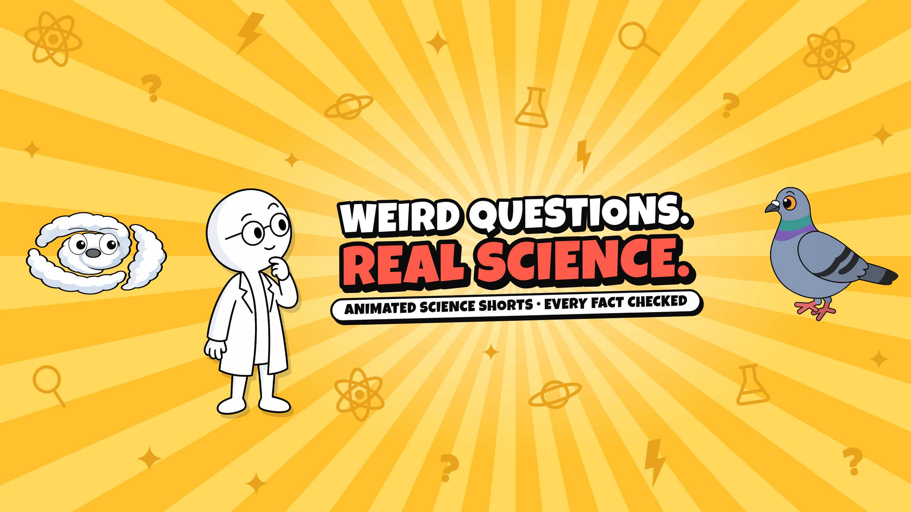
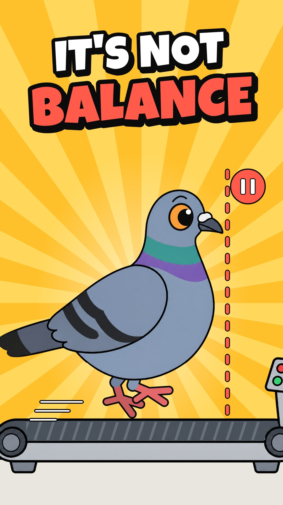
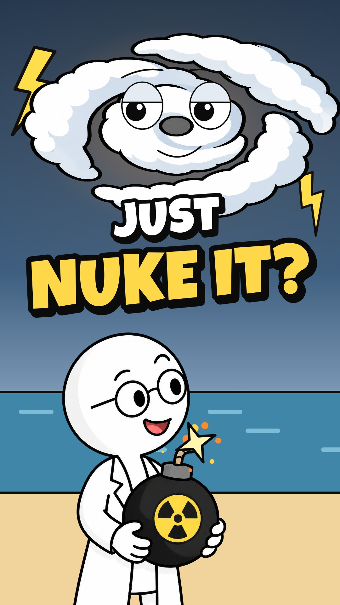
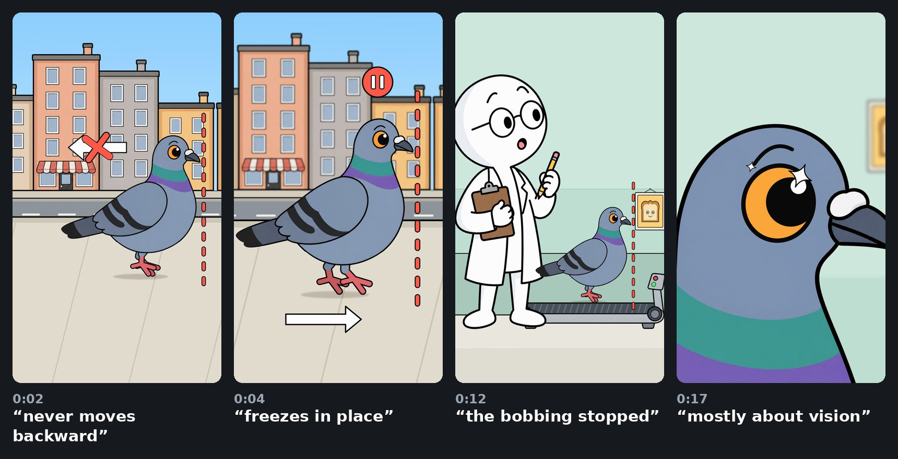
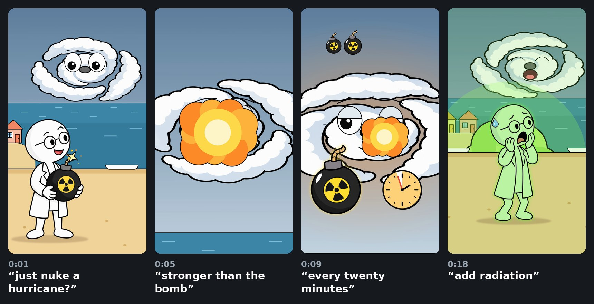

# YT-2D



**Cut-out cartoon YouTube Shorts, animated in code.**

YT-2D is a small production line for science Shorts. Each episode takes one surprising question and checks the facts against real research. It turns about 60 spoken words into a 20–25 second vertical cartoon with a voice-over, sound effects, a thumbnail and a title.

The look is classic cut-out animation: flat 2D drawings with thick black outlines. An AI image model draws the characters and props as separate cut-out pictures. Everything that moves is code, written with [Remotion](https://www.remotion.dev/) (React for video): the camera, poses, physics, faces and effects. Because the animation is code, every beat lands on the exact spoken word. Any shot can be re-timed or rendered again in 4K without redrawing anything.

The aim is a repeatable recipe. Every episode uses the same round-headed scientist, the same drawing style and the same pipeline, so a new Short is mostly a new script, a handful of new pictures and new animation code.

## Finished Shorts

<table>
  <tr>
    <td align="center" width="50%">
      <br>
      <b>Why Pigeons Bob Their Heads (It's Not What You Think)</b><br>
      24.9 s · <code>PigeonShort</code>
    </td>
    <td align="center" width="50%">
      <br>
      <b>Why Don't We Just Nuke a Hurricane?</b><br>
      20.6 s · <code>HurricaneShort</code>
    </td>
  </tr>
</table>

Both are rendered at 2160×3840 (4K vertical) and 60 fps, with the voice and sound effects mixed in. The MP4 files aren't stored in git; the commands under [Running it](#running-it) render them again.

### 1. Why pigeons bob their heads



> A walking pigeon's head never actually moves backward. It freezes in place while the body moves forward, then darts ahead. You'd think that's for balance. But when scientists put pigeons on a treadmill, the bobbing stopped. Their legs kept walking, but their view never changed. So it's mostly about vision. Each freeze gives a steady view, like holding a camera still, which probably helps them spot movement.

**The story:**
1. A pigeon walks down a city street. A red guide line shows that its head holds still, then darts ahead.
2. The scientist guesses "balance" and wobbles on one leg.
3. He puts the pigeon on a treadmill. Its legs keep walking, but its head stays on the line, and its view of a bread poster on the wall never changes.
4. A close-up of its eye, then a camera held still.
5. The pigeon snaps a falling crumb out of the air, which loops back to the first frame.

The pigeon is a puppet. Its head, neck and body are cut from one AI picture, and its legs, eye and eyebrow are drawn in code, so it walks with the real hold-then-dart rhythm.

**Sources:**
- [Frost 1978](https://journals.biologists.com/jeb/article/74/1/187/22520/The-Optokinetic-Basis-of-Head-Bobbing-in-the): the treadmill experiment.
- [Troje & Frost 2000](https://journals.biologists.com/jeb/article/203/5/935/8418/Head-Bobbing-in-Pigeons-How-Stable-is-the-Hold): how still the head stays during the hold.
- [Davies & Green 1988](https://journals.biologists.com/jeb/article/138/1/71/5562/Head-Bobbing-During-Walking-Running-and-Flying): the hold helps pigeons spot moving objects.
- [Necker 2007](https://doi.org/10.1007/s00359-007-0281-3): a review. It notes that the benefit to the bird hasn't been fully tested, which is why the script says "mostly" and "probably".

### 2. Why don't we just nuke a hurricane?



> Why don't we just nuke a hurricane? Because the hurricane is way stronger than the bomb. A big one gives off as much heat as a ten-megaton nuclear bomb every twenty minutes. So one more bomb might not even slow it down. And the trade winds would carry the radioactive fallout straight to land. You'd probably keep the storm and add radiation.

**The story:**
1. The scientist stands on a beach with a lit bomb under a sleeping hurricane, which wakes up on "hurricane".
2. He throws the bomb and the camera follows it into the storm. The explosion only makes the hurricane look smug.
3. A clock shows the storm putting out a bomb's worth of heat every 20 minutes, and the hurricane yawns.
4. The trade winds carry a green fallout cloud to the shore, and the storm laughs while the scientist glows green.
5. He pulls out another bomb, which loops back to the first frame.

**Sources:** the figures come from [NOAA's hurricane research FAQ](https://www.aoml.noaa.gov/hrd/tcfaq/C5c.html). It was offline when we checked, so they were confirmed through two reports that quote it: [National Geographic](https://www.nationalgeographic.com/science/article/hurricanes-weather-history-nuclear-weapons) and [CNN via WTOP](https://wtop.com/weather-news/2019/08/why-not-bomb-a-hurricane-noaa-gets-asked-about-it-all-the-time/).

## Long-form pilot: The Night Guard Had Every Key


This is a test of a second format: a long stick-figure survival story told in still pictures, like the "30 days locked inside…" videos. A new picture lands every 2–3 seconds, cut on the exact word, under a first-person voice-over. The pilot is the 4½-minute opening of a longer episode, in 16:9 at 1080p.

**The story (v2):** "The dead man pressing his face against my gate used to be my best friend." The cold open starts at the worst moment, then rewinds an hour. Danny Ruiz is the night guard at Maplecrest Mall (a made-up mall). He works nights so he's home when his daughter Lily gets off the school bus, and she calls him the king of the mall because he has 42 keys, one for every store. At 1 a.m. his friend Marcus, a 22-year-old nursing student, usually radios with a terrible joke. Tonight Marcus whispers about a man walking wrong up the garage ramp, then goes silent. The glass food court won't hold, and Danny has four minutes to pick one store to lock himself in. He picks the sporting goods store, then Marcus's radio and his own give him away. It ends on "hour 1 of 720" and a woman on the radio who "would turn out to be the most dangerous person in it."

**What changed after the first test** (feedback: more hooks, a better voice, a lead people connect with):
- **Script:** the cold open, a re-hook every 20–30 seconds, a visible four-minute countdown, and a lead with a life (a daughter, a friend worth losing, a dry sense of humor). The first script is kept as `images/mall/script-v1.md`.
- **Voice:** directed Gemini voices (`voice_gemini.py`) replace the flat local voice. See below.
- **New pictures:** a sunny bus-stop background, Lily, Danny at home, a paper crown, Lily's crayon drawing, the series title and end cards, a name tag, Black Friday shoppers against the same lot full of zombies, and a sepia memory insert.

**How it differs from the Shorts:**
- **Backgrounds:** 10 scenes from Seedream 5 Flash on Kie.ai (2K, 3.24 credits each, all used on the first try). The prompts are in `images/mall/prompts.json`.
- **Characters drawn in code:** there are no AI pictures of characters. The stick figures (with front and back views, a child version, crown, backpack and book), zombies, props, the mall map, labels, cards, the security-camera look and the stores' steel gates are all drawn in code (`src/mall/`). So Danny looks identical in every shot, and a new shot costs nothing.
- **Shots cued by words:** `src/mall/shots.tsx` lists 86 shots, and each starts on a phrase from the narration ("cut just before *Glass doors*"). `timing.ts` turns the phrases into times using the word timings, so a new voice-over re-times every cut by itself.
- **Voice:** ElevenLabs on Kie.ai timed out on every request for hours (all refunded), so v2 uses Gemini 3.1 Flash TTS on Kie.ai. Each line is one short take with a voice, a style (Whisper, Deadpan, Vocal Smile…), a pace, a written character profile and inline tags such as `[whispers]`. Gemini sometimes cuts a take short, drops words or adds some, so every take is transcribed and compared with the script, and a take that doesn't match is recorded again; `--check` re-checks saved takes. Long pauses inside takes are shortened and the pace is lifted 6%. The voices are Algenib (Danny), Puck (Marcus) and Achernar (the woman); auditions of the alternatives are in `images/mall/vo/audition/`.
- **Sound:** 18 effects and ambience loops from Suno sounds on Kie.ai (2.5 credits per request, two takes each) plus a synthesized clock tick, mixed in `src/mall/Sfx.tsx`.

**Cost:** about 130 Kie.ai credits ($0.65) for both versions together. That's 35 credits for backgrounds, 45 for sounds, about 29 for the v2 narration and 22 for voice auditions. A 40-minute episode would use the same pipeline. It needs about 6,000 words, roughly 1,000 shots and maybe 40 more backgrounds, so pictures, sound and Gemini narration would cost a few dollars. Most of the work is writing the script and the shot list.

The upload details are in `publish/mall-pilot-upload.md` and the thumbnail is `thumbnails/mall-pilot-thumbnail.jpg`.

## The house style

- **Format:** vertical 9:16, 20–25 seconds. The voice sets the length.
- **Script:** 50–70 words of plain spoken English, with every fact checked against primary sources. No "Did you know", no hype, no calls to action. Where the science is uncertain, the script says so ("mostly", "probably").
- **Frame 0** shows the premise and works as a thumbnail. The last frame loops back to it.
- **Beats:** one visual beat per line, landing on the exact spoken word, with one gag per beat.
- **Art:** flat 2D cut-outs with thick black outlines and flat colours. The same round-headed scientist with glasses and a lab coat appears in every episode.
- **Motion:**
  - a 2.5D multiplane camera with depth of field
  - squash-and-swap pose changes instead of cross-fades
  - anticipation and follow-through, and real projectile physics
  - breathing, small impact shakes and faces on objects
- **Sound:** effects on their own layer under the voice.

## How a Short is made

| Step | What happens | Where |
|---|---|---|
| 1. Script | Research a surprising question, check it against papers, universities and agencies, and write the voice-over. | `images/*/beats.md`, this README |
| 2. Voice | The voice-over is generated with the ElevenLabs voice "Chris" through vidIQ. | `public/*/vo/take1.mp3` |
| 3. Word timings | faster-whisper finds when each word is spoken; pauses are found from loudness. | `words.py` → `images/*/words.json` |
| 4. Beat sheet | Lists what's on screen and which sound plays for every line, timed to the word. | `images/*/beats.md` |
| 5. Pictures | GPT Image 2.5 draws each pose and prop on a flat key colour. Earlier pictures are used as references to keep the characters and style consistent. | `images/*/prompts.md`, `images/*/raw/` |
| 6. Cut-outs | The background is keyed out to transparency and the outline edges are cleaned. Each sprite is then measured (feet, head, eye, the bomb's fuse…) so code can line it up. | `key.py`, `prep_*.py` → `src/*/sprites.ts` |
| 7. Animation | Remotion compositions draw the camera, layers, poses, physics and effects in code. | `src/pigeon/`, `src/hurricane/` |
| 8. Sound | Sound effects are synthesized in Python and mixed on their own layer. | `sfx.py`, `src/*/Sfx.tsx` |
| 9. QA | Three checks: stills and contact sheets; a scan for sudden jumps between frames; a check of size, frame rate, length and loudness. | `scripts/` |
| 10. Render | The 1080×1920 compositions are rendered at 2× scale, giving 2160×3840 at 60 fps. | `npx remotion render` |
| 11. Packaging | Thumbnails are Remotion stills built from the same art. Titles are brainstormed and scored with vidIQ. | `src/thumbs/`, `thumbnails/` |

## Repository layout

```
src/
  Root.tsx        registers the videos, thumbnails and channel art (PigeonShort, HurricaneShort, PigeonThumb, HurricaneThumb, ChannelBanner, ChannelPicture)
  pigeon/         pigeon Short: shots (Street, Lab, Close, CamGuy), pigeon rig and walk, effects, sound mix, beat times
  hurricane/      hurricane Short: one continuous 2.5D shot, sound mix, beat times
  thumbs/         thumbnails, rendered as Remotion stills
  channel/        channel banner and picture, rendered as Remotion stills
  mall/           long-form mall pilot: stick-figure rig, overlays, mall map, the 70-shot list, word cues, sound mix, thumbnail
public/           everything the videos load: cut-out sprites, backgrounds, voice-overs, sound effects, thumbnail font
images/
  pigeon/         prompts, beat sheet, word timings, raw and keyed pictures, QA sheets, pipeline scripts
  hurricane/      the same for the hurricane Short
  mall/           the pilot's script, background prompts, Kie.ai helpers (backgrounds, voice, sounds), local voice and word-timing scripts
scripts/          QA tools (stills, contact sheets, pop scan, verify) and the README storyboard maker
thumbnails/       final thumbnails, ready to upload (1080×1920 JPG)
publish/          what goes on YouTube: upload details, channel banner and picture, channel text
docs/             storyboard strips used in this README
```

## Running it

You need Node.js (the project was built with Node 22) and ffmpeg. Python 3 with numpy, opencv-python and Pillow is only needed for the QA tools and for remaking assets. Word timings also need faster-whisper.

```bash
npm install
npm run studio      # Remotion Studio: play and scrub both Shorts in the browser
```

Render the Shorts in 4K, the thumbnails and the channel art:

```bash
npx remotion render src/index.ts PigeonShort out/pigeon-head-bob-4K.mp4 --scale=2 --crf=16 --pixel-format=yuv420p
npx remotion render src/index.ts HurricaneShort out/hurricane-nuke-4K.mp4 --scale=2 --crf=16 --pixel-format=yuv420p
npx remotion still src/index.ts PigeonThumb out/pigeon-thumbnail.png
npx remotion still src/index.ts HurricaneThumb out/hurricane-thumbnail.png
npx remotion still src/index.ts ChannelBanner publish/channel-banner.png
npx remotion still src/index.ts ChannelPicture publish/channel-picture.png
```

Render the mall pilot (1080p, 30 fps) and its thumbnail:

```bash
npx remotion render src/index.ts MallPilot out/mall-pilot-v2-1080p.mp4 --crf=18 --pixel-format=yuv420p --audio-bitrate=256k
bash images/mall/finish.sh out/mall-pilot-v2-1080p.mp4 out/mall-pilot-v2.mp4   # loudness to -15 LUFS, smaller re-encode for upload
npx remotion still src/index.ts MallThumb out/mall-thumb.png
```

To re-voice the pilot, change the voices or lines in `images/mall/vo/v2/plan.json`, delete the takes you want recorded again from `vo/v2/takes/`, rebuild the voice track and word timings, then render again. Every cut follows the new timings by itself:

```bash
cd images/mall
python3 voice_gemini.py vo/v2/plan.json vo/v2            # records missing takes, checks each against the script, builds vo.wav
python3 voice_gemini.py vo/v2/plan.json vo/v2 --check    # re-check every saved take without recording
python3 align.py vo/v2/vo.wav vo/v2/segments.json ../../src/mall/words.json
ffmpeg -i vo/v2/vo.wav -af loudnorm=I=-16:TP=-1.5 -b:a 192k ../../public/mall/vo/vo.mp3
```

The first test's free local voice is still available: `voice_local.py` (Kokoro, model files from the kokoro-onnx releases on GitHub) writes the same `vo.wav` and `segments.json`.

Check a render:

```bash
node scripts/stills.mjs out/qa 0.5 HurricaneShort 0 4.8 9.5 18.3   # PNG stills at these seconds
python3 scripts/sheet.py out/qa out/qa-sheet.jpg 4                   # contact sheet of those stills
python3 scripts/popscan.py out/hurricane-nuke-4K.mp4                 # flags sudden jumps between frames
bash scripts/verify.sh out/hurricane-nuke-4K.mp4                     # size, frame rate, frame count, length, loudness
python3 scripts/storyboard.py out/hurricane-nuke-4K.mp4 docs/hurricane-storyboard.jpg \
  "1.3|just nuke a hurricane?" "5.15|stronger than the bomb" "9.5|every twenty minutes" "18.3|add radiation"
```

### Remaking assets

These scripts live in `images/pigeon/scripts/`, with the hurricane's own `prep.py`, `sfx.py` and `storm_bed.py` in `images/hurricane/`. Each script's usage is in its first lines.

| Script | What it does |
|---|---|
| `kie.py` | Generates GPT Image 2.5 pictures (and other Kie.ai jobs). It reads the key from the `KIE_API_KEY` environment variable. Keys are never stored in the repo. |
| `key.py` | Turns the flat background transparent and cleans the outline edge. `--no-holes` keeps enclosed areas, such as windows. |
| `prep_pigeon.py` | Splits the pigeon picture into head, neck and body for the rig. |
| `prep_all.py`, `prep.py` | Measure every sprite, copy it to `public/` and write `sprites.ts`. |
| `words.py` | Writes word timings for a voice-over file. |
| `sfx.py`, `storm_bed.py` | Synthesize the sound effects and background ambience. |

## Tools and services

| Job | Tool |
|---|---|
| Animation and rendering | [Remotion](https://www.remotion.dev/) 4.0.539 with React and TypeScript |
| Pictures | GPT Image 2.5 Flare through [Kie.ai](https://kie.ai/), 2K, on a flat key-colour background |
| Voice | ElevenLabs premade voice "Chris", generated through [vidIQ](https://vidiq.com/) |
| Mall pilot backgrounds | Seedream 5 Flash through Kie.ai, 2K, 16:9 |
| Mall pilot voice | Gemini 3.1 Flash TTS through Kie.ai (v2); [Kokoro](https://github.com/hexgrad/kokoro) via [kokoro-onnx](https://github.com/thewh1teagle/kokoro-onnx), open source and local, for the first test |
| Mall pilot sound effects | Suno sounds (V6) through Kie.ai, plus a synthesized clock tick |
| Word timings | [faster-whisper](https://github.com/SYSTRAN/faster-whisper) |
| Sound effects | Mostly synthesized with numpy. The pigeon's street and treadmill ambience was generated with Suno through Kie.ai. |
| Titles | vidIQ title ideas and scores |
| Thumbnail font | [Luckiest Guy](https://fonts.google.com/specimen/Luckiest+Guy), Apache License 2.0 (license in `public/fonts/`) |

Remotion is free for individuals and small teams; larger companies need a company license. See [remotion.dev/license](https://www.remotion.dev/license).

## What the first two Shorts cost

| | Pigeon | Hurricane |
|---|---|---|
| Pictures (Kie.ai, 10 credits each) | 10 pictures, 100 credits | 7 pictures, 70 credits |
| Generated sounds (Kie.ai) | 7.5 credits | 2.5 credits (the storm sound never arrived, so it was synthesized instead) |
| Voice-over (vidIQ) | 14 credits | 14 credits |
| Title ideas (vidIQ) | 5 credits | 5 credits |

## Next ideas

The topics so far are animals (pigeons) and weather (hurricanes), so the next ones should come from other areas. These ideas were looked at but not made yet. Each needs its own fact check before it gets a script.

- why the Leaning Tower of Pisa survives earthquakes
- hay dust and the holes in Swiss cheese
- blue sunsets on Mars
- bread going stale faster in the fridge
- woodpecker skulls
- why runways get renumbered
- how much a cloud weighs
- why you can't tickle yourself
